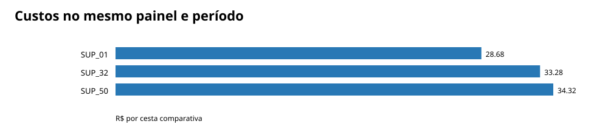
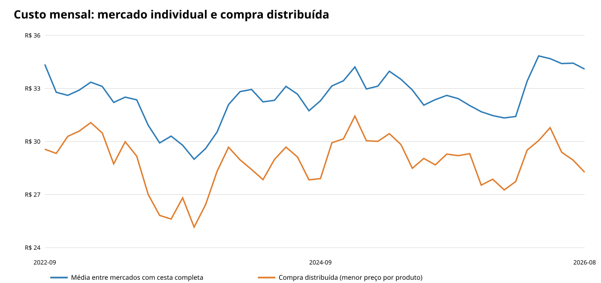

# Questão 1 — Comparação econômica

## Questão
Quais mercados têm menor custo de uma cesta equivalente e qual economia potencial de distribuir as compras?

## Objetivo e motivação
Apoiar a comparação de alternativas de compra. A aplicação direta depende de identificar as lojas, conhecer os itens consumidos e descontar transporte.

## Método e avaliação
Cesta comparativa de referência: uma unidade-base de cada produto (1 kg ou 1 L). É um índice de comparação de preços, não uma estimativa de consumo mensal familiar.
Os cinco itens básicos não perecíveis ou de compra frequente permitem uma comparação reduzida com cobertura longitudinal; não representam a composição nutricional oficial de uma cesta básica. Quantidades unitárias isolam a comparação de preços sem inventar consumo familiar.
Preço representativo: média mensal das ofertas válidas em cada mercado. O custo é a soma de preço por unidade × quantidade da cesta. Item ausente torna a cesta incompleta, nunca custo zero.
O ranking principal usa somente mercados com cesta completa em TODOS os meses da janela global, selecionados pela cobertura, sem olhar os menores preços. Todas as médias comparam os mesmos meses. É um painel restrito, não uma classificação de todas as lojas.
A análise complementar compara pares com pelo menos 24 meses comuns. A diferença A−B usa somente a interseção exportada em comparacoes_pareadas.csv. Pares com períodos distintos não formam um ranking global. O corte reduz comparações com pouco histórico; a sensibilidade ao corte consta no relatório coletivo.
Empates recebem a mesma posição mínima; cada empatado conta como vencedor do mês. A frequência divide vitórias pelos meses do painel. Top-3 é complementar e pouco informativo se o painel tem apenas três lojas.
Rankings anuais usam o mesmo painel e os mesmos meses dentro de cada ano. A correlação de Spearman entre anos usa apenas anos com 12 meses, evitando comparar estações distintas. Não há inferência causal.
Compra distribuída escolhe o mínimo por item apenas entre lojas do mesmo painel, no mesmo mês. Apresentamos a economia frente a cada loja e frente ao melhor mercado único. São mínimos de médias mensais, não ofertas garantidas disponíveis simultaneamente. Deslocamento não entra no cálculo.

## Resultados
Painel: 3 mercados, 48 meses, 09/2022–08/2026. Menor custo médio neste painel: SUP_01, R$ 28.68.
Economia média da distribuição frente ao melhor mercado único: R$ 0.11 (0.36%, média dos percentuais mensais).

| Mercado | Meses | Custo médio (R$) | Meses com menor custo |
| --- | ---: | ---: | ---: |
| SUP_01 | 48 | 28.68 | 48 |
| SUP_32 | 48 | 33.28 | 0 |
| SUP_50 | 48 | 34.32 | 0 |

## Conclusão e discussão
SUP_01 tem o menor custo médio entre as lojas do painel, não necessariamente entre todas as lojas da cidade. A redução do painel é o preço da comparação temporal rigorosa; os demais mercados são examinados apenas em pares.
A economia calculada é bruta: só compensa distribuir compras se superar transporte e outros custos. Não equivale a economia mensal de uma família sem informar sua cesta e frequência de compra.
Comparações pareadas elegíveis: 372; veja meses e diferenças no CSV.
Unidades são inferidas, códigos SUP_* não identificam endereços e preços são nominais. Marcas, cobertura e quantidades afetam as conclusões. Não há custo de transporte, ponderação por vendas ou garantia de disponibilidade.
Cobertura/exclusões: cobertura_cesta.csv; cestas completas e incompletas: custos_disponiveis.csv; parâmetros: config_utilizada.json; estabilidade: ranking_anual.csv e estabilidade_anual.csv.
