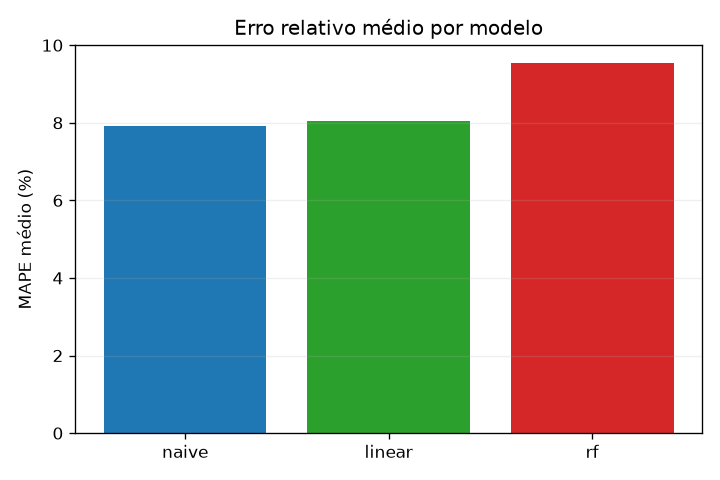
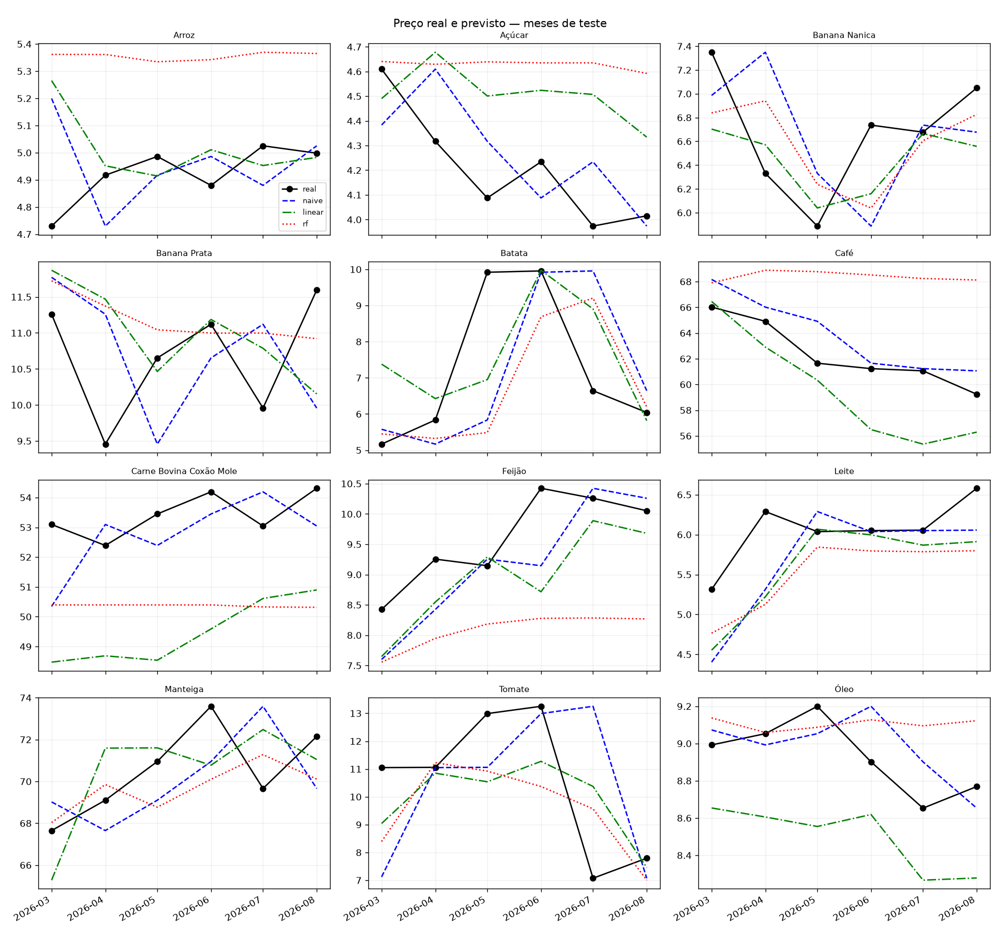
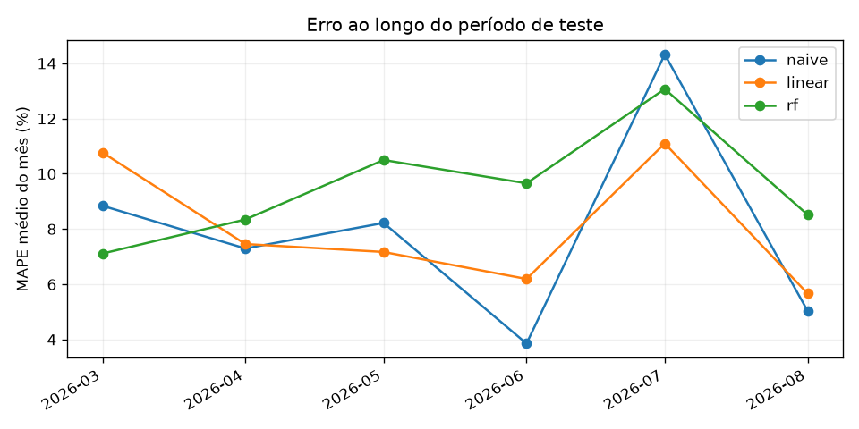

# Questão 3 — previsão de preços da cesta básica

## Questão e objetivo

É possível prever o preço médio dos produtos da cesta básica no mês seguinte usando dados históricos? O objetivo é avaliar se a previsão ajuda a reservar recursos para a compra do próximo mês.

## Método

- Entrada: `series_geral.csv` (12 produtos com 48/48 meses válidos e unidade conhecida). Produtos com lacunas, poucos meses ou unidade desconhecida foram excluídos sem imputação.
- Variáveis: lags 1, 2, 3, 12, médias móveis 3, 6 calculadas com deslocamento de um mês, seno/cosseno do mês. Toda feature usa apenas preços até t-1.
- Divisão cronológica: 36 meses marcados como treino, dos quais 24 entram no modelo após o aquecimento do lag 12; 6 de validação e 6 de teste (2026-03 a 2026-08). O grid do Random Forest foi escolhido pelo MAPE na validação; os modelos finais foram reajustados em treino+validação e avaliados uma única vez no teste.
- Modelos: Naive (último preço observado), regressão linear padronizada e Random Forest. Métricas: MAE, RMSE e MAPE, comparadas com o Naive.

## Avaliação

| Modelo | MAE médio (R$/unidade) | RMSE médio | MAPE médio (%) | Diferença de MAPE vs Naive (p.p.) |
| --- | ---: | ---: | ---: | ---: |
| naive | 0.9944 | 1.2329 | 7.93 | +0.00 |
| linear | 1.2671 | 1.4582 | 8.06 | +0.13 |
| rf | 1.5425 | 1.7280 | 9.53 | +1.61 |

Modelo de menor MAPE médio: **naive**. Vitórias por produto (menor MAPE): naive=6, linear=3, rf=3.
MAE e RMSE são agregados apenas para referência: as unidades são kg, L e unidade, então o MAPE é a medida comparável entre produtos.

## Conclusão

No período de teste, o modelo **naive** apresentou o menor erro relativo médio. Nenhum modelo superou a referência Naive em média, o que indica pouco ganho previsível com as variáveis utilizadas.
A previsão do próximo mês é um ponto estimado; o erro histórico do modelo é a medida de incerteza disponível, não um intervalo de confiança.

## Previsão para o mês seguinte

| Produto | Unidade | Mês | Modelo | Preço previsto |
| --- | --- | --- | --- | ---: |
| Arroz | kg | 2026-09 | linear | 5.0529 |
| Arroz | kg | 2026-09 | naive | 4.9981 |
| Arroz | kg | 2026-09 | rf | 5.0614 |
| Açúcar | kg | 2026-09 | linear | 4.0639 |
| Açúcar | kg | 2026-09 | naive | 4.0152 |
| Açúcar | kg | 2026-09 | rf | 4.1739 |
| Banana Nanica | kg | 2026-09 | linear | 7.2187 |
| Banana Nanica | kg | 2026-09 | naive | 7.0492 |
| Banana Nanica | kg | 2026-09 | rf | 7.2992 |
| Banana Prata | kg | 2026-09 | linear | 11.5981 |
| Banana Prata | kg | 2026-09 | naive | 11.5965 |
| Banana Prata | kg | 2026-09 | rf | 11.2007 |
| Batata | kg | 2026-09 | linear | 6.5152 |
| Batata | kg | 2026-09 | naive | 6.0419 |
| Batata | kg | 2026-09 | rf | 5.5192 |
| Café | kg | 2026-09 | linear | 58.2222 |
| Café | kg | 2026-09 | naive | 59.2394 |
| Café | kg | 2026-09 | rf | 60.7627 |
| Carne Bovina Coxão Mole | kg | 2026-09 | linear | 54.9584 |
| Carne Bovina Coxão Mole | kg | 2026-09 | naive | 54.3104 |
| Carne Bovina Coxão Mole | kg | 2026-09 | rf | 53.0738 |
| Feijão | kg | 2026-09 | linear | 9.4212 |
| Feijão | kg | 2026-09 | naive | 10.0530 |
| Feijão | kg | 2026-09 | rf | 9.7149 |
| Leite | L | 2026-09 | linear | 6.2579 |
| Leite | L | 2026-09 | naive | 6.5801 |
| Leite | L | 2026-09 | rf | 6.0922 |
| Manteiga | kg | 2026-09 | linear | 74.1780 |
| Manteiga | kg | 2026-09 | naive | 72.1504 |
| Manteiga | kg | 2026-09 | rf | 72.6370 |
| Tomate | kg | 2026-09 | linear | 7.2459 |
| Tomate | kg | 2026-09 | naive | 7.7942 |
| Tomate | kg | 2026-09 | rf | 7.7079 |
| Óleo | L | 2026-09 | linear | 8.7765 |
| Óleo | L | 2026-09 | naive | 8.7689 |
| Óleo | L | 2026-09 | rf | 9.0668 |

## Interpretação por produto

| Produto | Menor MAPE no teste | MAPE (%) | MAE (R$/unidade) |
| --- | --- | ---: | ---: |
| Arroz | linear | 2.99 | 0.1436 |
| Açúcar | naive | 4.73 | 0.1996 |
| Banana Nanica | linear | 5.15 | 0.3533 |
| Banana Prata | rf | 7.57 | 0.7684 |
| Batata | rf | 18.78 | 1.5345 |
| Café | naive | 2.38 | 1.4877 |
| Carne Bovina Coxão Mole | naive | 2.39 | 1.2776 |
| Feijão | naive | 5.98 | 0.5687 |
| Leite | naive | 7.52 | 0.4469 |
| Manteiga | rf | 2.44 | 1.7445 |
| Tomate | linear | 17.48 | 1.7144 |
| Óleo | naive | 1.78 | 0.1584 |

O vencedor por produto é uma descrição posterior do teste, não uma seleção validada para implantação. Não selecionar hiperparâmetros por essas vitórias.
Os lags 1–3 capturam persistência recente; lag 12 representa o mesmo mês do ano anterior. Médias 3/6 suavizam ruído; seno/cosseno preservam continuidade do calendário. São escolhas parcimoniosas para apenas 48 meses.
Grid RF: 100/300 árvores, profundidade livre/5, mínimo 1/3 observações por folha. A validação temporal escolhe MAPE; profundidade e tamanho de folha controlam complexidade. Há poucos exemplos para modelos flexíveis.
Teste: previsões sequenciais a um passo com preços reais conhecidos até o mês anterior, sem reajustar pesos dentro do bloco. Não é previsão simultânea de seis meses.
Depois de congelar métricas, modelos operacionais são reajustados em todo o histórico com os mesmos hiperparâmetros. A coluna treinado_ate documenta o corte. O mês seguinte é relativo ao fim da base, não à data em que este relatório é lido.
Aplicação: para uma quantidade explicitada q de um único produto, q × MAE ilustra a magnitude média histórica do erro monetário. Isso não é margem garantida nem intervalo de confiança; combinar erros de produtos exige avaliar a cesta conjunta. Sem consumo familiar informado não estimamos orçamento mensal.

## Limitações

- A janela tem apenas 48 meses (cerca de quatro ciclos anuais) e 12 meses de aquecimento para o lag 12.
- Unidades são inferidas e não confirmadas pela fonte; preços são nominais.
- Selecionar séries completas é viés de sobrevivência: produtos com histórico curto ficam de fora.
- A série geral pondera mercados igualmente; mudanças na composição de lojas afetam o preço médio.
- Hiperparâmetros foram escolhidos retrospectivamente na validação; não houve avaliação prospectiva cega.
- Sem pesos de consumo, inflação ou promoções: a previsão não substitui o orçamento familiar.
