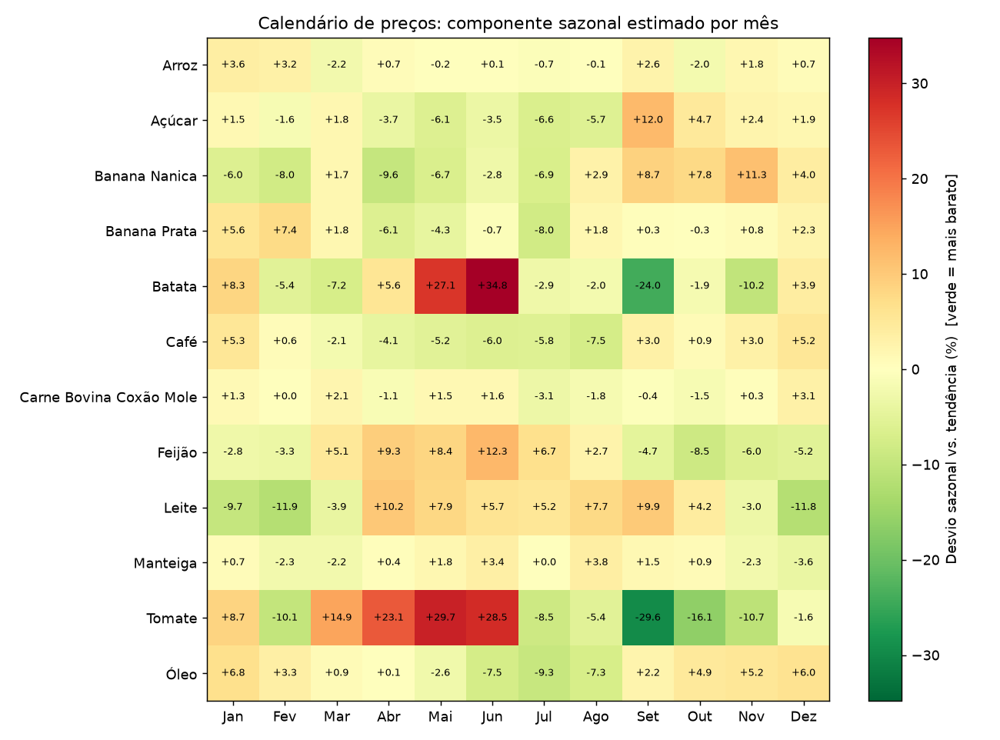

# Questão 2 — Sazonalidade dos preços

## Questão
Há padrões recorrentes que indiquem épocas potencialmente mais econômicas para adquirir os produtos?

## Objetivo e motivação
Apoiar o planejamento de compras, distinguindo tendência de longo prazo e oscilações recorrentes. Um mês historicamente favorável não garante desconto futuro.

## Método e avaliação
Selecionamos séries mensais gerais completas com preços positivos e unidade única conhecida (ainda inferida). A média geral atribui peso igual aos mercados disponíveis; a composição pode mudar. Elegibilidade e exclusões estão no CSV.
STL robusta no log do preço, período 12, janela sazonal padrão 7. O log expressa variações proporcionais. Médias móveis 3 meses retrospectiva e 12 centrada são apenas descritivas e não entram em previsão. Volatilidade: desvio-padrão das diferenças mensais do log.
Força sazonal: máximo entre zero e 1 − Var(resíduo)/Var(sazonal+resíduo). ACF sobre diferenças do log reduz tendência; linhas ±1,96/raiz(n) são referências aproximadas de ruído branco, sem correção para múltiplas comparações, não um teste confirmatório.
Comparamos perfis anuais sem tendência por correlação, exigindo ao menos seis meses comuns por par de anos. Anos parciais são identificados nas tabelas. Indício exploratório: força sazonal e correlação média ≥0,30. Esses cortes buscam sinais não triviais, são escolhas operacionais e não níveis de significância; a sensibilidade é apresentada abaixo.

## Resultados e avaliação
12 produtos completos analisados. A classificação e meses extremos descrevem esta amostra, não recomendações universais.
| Produto | Força sazonal | Correlação entre anos | Indício | Mês de menor componente |
| --- | ---: | ---: | --- | --- |
| Arroz | 0.254 | -0.076 | não | Mar |
| Açúcar | 0.000 | -0.047 | não | Jul |
| Banana Nanica | 0.598 | 0.306 | sim | Abr |
| Banana Prata | 0.295 | 0.151 | não | Jul |
| Batata | 0.448 | 0.349 | sim | Set |
| Café | 0.000 | -0.290 | não | Ago |
| Carne Bovina Coxão Mole | 0.138 | -0.073 | não | Jul |
| Feijão | 0.471 | 0.149 | não | Out |
| Leite | 0.449 | 0.441 | sim | Fev |
| Manteiga | 0.000 | 0.142 | não | Dez |
| Tomate | 0.642 | 0.435 | sim | Set |
| Óleo | 0.175 | 0.321 | não | Jul |

Corte exploratório 0.2 em ambas as medidas: 4 produtos com indício.
Corte exploratório 0.3 em ambas as medidas: 4 produtos com indício.
Corte exploratório 0.5 em ambas as medidas: 0 produtos com indício.

## Conclusão e discussão
Indícios pelos critérios principais: Banana Nanica, Batata, Leite, Tomate.
O objetivo de explorar épocas favoráveis foi atendido de forma descritiva. Produtos sem consistência suficiente não sustentam indicação de um mês de compra. ACF, força e comparação entre anos são evidências complementares, não prova causal.
Há apenas quatro ciclos na base original; o ajuste e a avaliação descritiva usam a mesma amostra. Clima, inflação e entrada/saída de lojas podem alterar os perfis. Não extrapolar para anos futuros sem novas observações.
Mesmo com indício, antecipar compras depende de conservação, espaço, necessidade e capital disponível; especialmente perecíveis não devem ser estocados só pelo calendário.

Os CSVs de médias móveis, perfil por ano e resumo sustentam a análise. Figuras stl_* e acf_* mostram cada produto; as unidades de preço constam em elegibilidade.csv.
